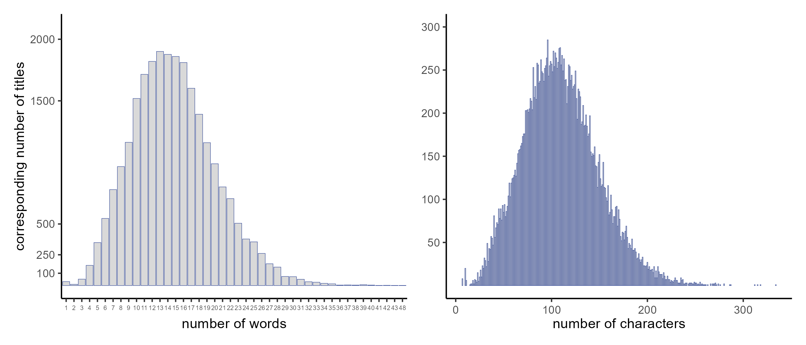
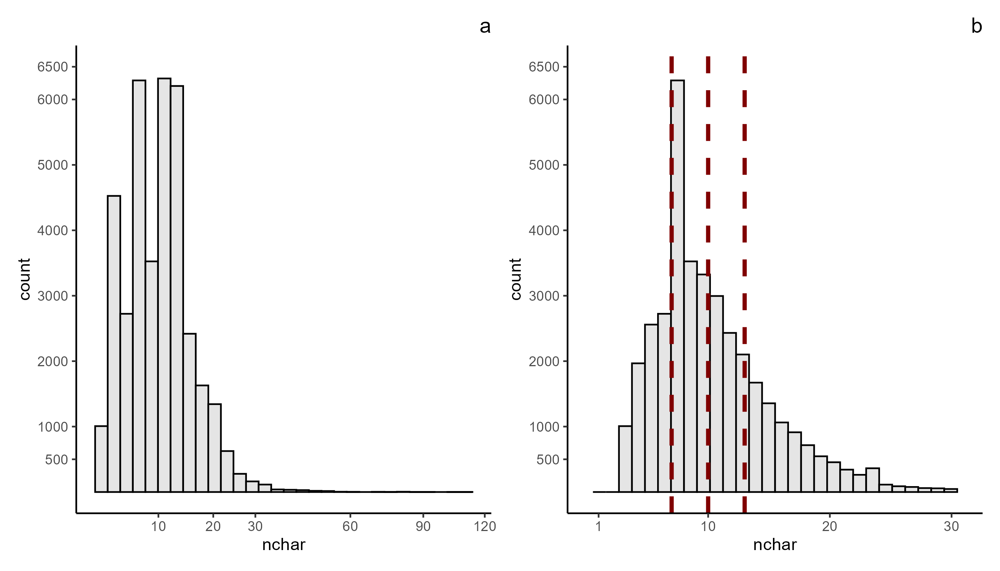
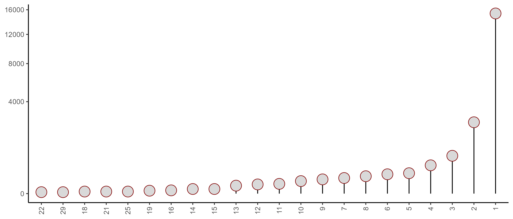
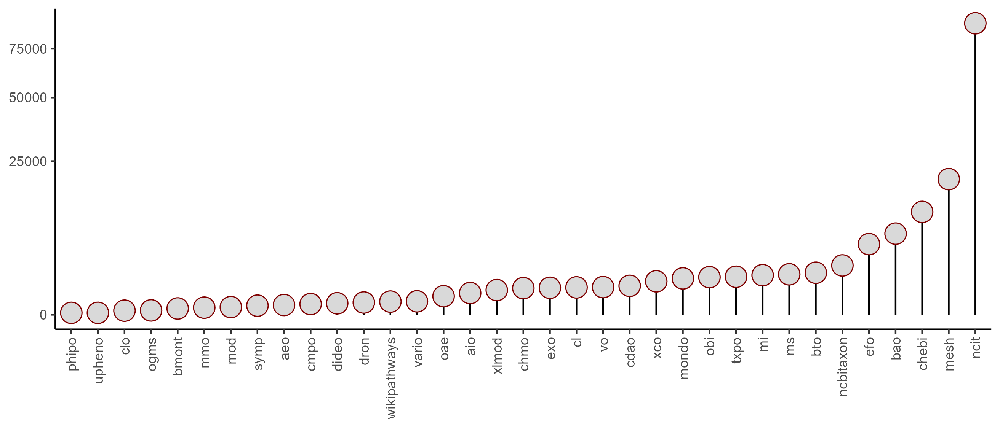
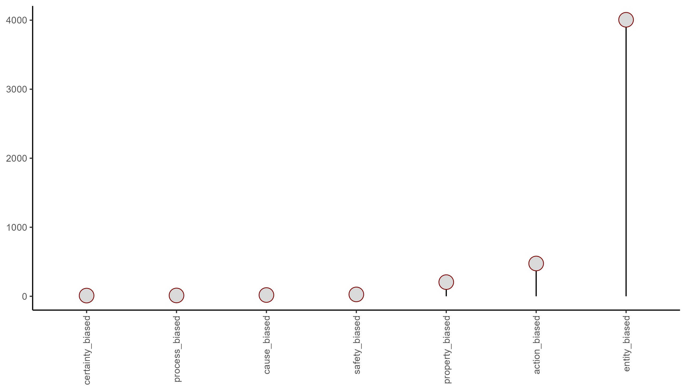

# safety_-_molecularTargets
A glance at the current state of the studies connecting molecular targets and drug safety and development.  

## Work in progress, readme will be updated with the references to the tools and materials used. Licensing of the materials should be done in the case of external usage, all the results obtained on the previous works of https://en.ibmc.msk.ru/departments?view=article&id=26:laboratory-of-structure-function-based-drug-design&catid=10:data and community

Interaction with undesired molecular targets is one of the reasons why (small molecule) drug candidate may fail during development or developed drug could be recalled from the market.

However, the exact list of undesired molecular targets is a hard topic, since it may vary greatly depending on the exact condition to be treated and multiple other factors.

Thus, in addition to the complex studies aiming to develop such a list or lists (using complex techniques belonging to different approaches) to be applied widely, it is of interest to know what are the molecular targets being studied as potentially safety issues related by the scientiffic community.  

To do that it is possible to simply scan the list of the articles recently (**01.01.2021 - 15.10.2026** in this case) published in the scientiffic journals dedicated to the studies of drug safety and development (subject categories, https://www.scimagojr.com/)
in the search for ones, in which potential connection between the molecular target and certain undesired outcome is unequivocally stated.

## Journals were selected among ones related to Drug Development (category) and Drug Safety (title):

1.	Nature Reviews Drug Discovery; https://www.nature.com/nrd/
2.	Cell Chemical Biology; https://www.cell.com/cell-chemical-biology/home
3.	Molecular Therapy; https://www.cell.com/molecular-therapy-family/home   ->   Molecular Therapy Advances
4.	Medicinal Research Reviews; 
5.	MedComm; https://onlinelibrary.wiley.com/journal/26882663
6.	Drug Discovery Today; https://www.sciencedirect.com/journal/drug-discovery-today
7.	Journal of Pharmaceutical Analysis; https://www.journals.elsevier.com/journal-of-pharmaceutical-analysis
8.	Current Opinion in Pharmacology; https://www.sciencedirect.com/journal/current-opinion-in-pharmacology
9.	Expert Opinion on Therapeutic Targets; https://www.tandfonline.com/journals/iett20
10.	Drug Design, Development and Therapy; https://www.tandfonline.com/journals/dddt20
11.	Expert Opinion on Drug Discovery; https://www.tandfonline.com/journals/iedc20
12.	Medicine in Drug Discovery; https://www.sciencedirect.com/journal/medicine-in-drug-discovery
13.	Molecular Pharmaceutics; https://pubs.acs.org/mpohbp
14. Drug Development Research; https://onlinelibrary.wiley.com/journal/10982299
15.	RSC Medicinal Chemistry; https://www.rsc.org/journals-books-databases/about-journals/rsc-medicinal-chemistry/
16.	Current Drug Targets; https://www.eurekaselect.com/journal/13
17. Mini-Reviews in Medicinal Chemistry; https://www.eurekaselect.com/journal/56
18. Chemical Biology and Drug Design; https://onlinelibrary.wiley.com/journal/17470285
19. Current Pharmacology Reports; https://link.springer.com/journal/40495
20. Drug Research; https://www.thieme.in/drug-research
21. Drug Development and Industrial Pharmacy; https://www.tandfonline.com/journals/iddi20
22. Journal of Pharmaceutical Innovation; https://www.springer.com/journal/12247
23. Assay and Drug Development Technologies; https://home.liebertpub.com/publications/assay-and-drug-development-technologies/118/overview
24.	Current Drug Discovery Technologies; https://www.eurekaselect.com/journal/68
25.	International Journal of Drug Discovery and Pharmacology; https://www.sciltp.com/journals/ijddp
26. Pharmaceutical Patent Analyst; https://www.future-science.com/journal/ppa
27. Expert Review of Precision Medicine and Drug Development; https://www.tandfonline.com/journals/tepm20
28. Pharmaceutical Chemistry Journal; https://www.springer.com/journal/11094
29. Drug Safety; https://www.springer.com/journal/40264
30. Pharmacoepidemiology and Drug Safety; https://onlinelibrary.wiley.com/journal/10991557
31. Expert Opinion on Drug Safety; https://www.tandfonline.com/journals/ieds20
32. Therapeutic Advances in Drug Safety; https://journals.sagepub.com/home/taw 
34. Current Drug Safety; https://www.eurekaselect.com/journal/11
35. Drug, Healthcare and Patient Safety; https://www.tandfonline.com/journals/dhps20
36. Frontiers in Drug Safety and Regulation; https://www.frontiersin.org/journals/drug-safety-and-regulation

## Articles's titles (25356) were obtained via PubMed, the results were downloaded manually and gathered using R and Tidyverse

## The scan of the titles will be conducted manually after sorting, just to get the whole picture of the studies in the field with safety assessement emphasized

Articles' titles should be arranged for the ease of the scanning and it is a task of its own.

Previous work with assays' descriptions from ChEMBL has shown that UMAP may be used to arrange short texts in a convinient way to some extent, latter studies shown that such convinence could be, probably, improved further [Pogodin, P. V. (2025). Local and global data structure preservation in dimensionality reduction: a case study of the UMAP algorithm. In New horizons of applied mathematics (Vol. 2, pp. 105-107).].

The question at this point is how to describe the articles' titles in computer.

The main idea at this point is to use both topological character-based descriptors similar to MNA-descriptors developed previously to represent chemical compounds [Filimonov, D., Poroikov, V., Borodina, Y., & Gloriozova, T. (1999). Chemical similarity assessment through multilevel neighborhoods of atoms: definition and comparison with the other descriptors. Journal of chemical information and computer sciences, 39(4), 666-670.] and list of entities present both in articles' titles and biomedical ontologies, which belong to the important topics in the field of biomedicine.

Such an approach will allow to consider both simple similarity of the articles' titles being studied and similarity of the lists of topics being reflected in these titles. Also, the latter will allow to immediately locate the most of the articles related to the topic of preclinical safety assessement, which is of interest in this study.

**NB:**

- This work is not intended to represent comprehensive study of the text descriptors, thus, those, which are known to the author will be used.

- Unicode characters (https://en.wikipedia.org/wiki/Unicode) are widely used in the scientiffic writing, and still their processing is somewhat problematic when different tools are applied in combination, despite the fact that these tools hadle Unicode characters well. Thus, and since full automation of the processing is not the goal here, Unicode characters will be omitted from the analysis, despite the fact that it could have great influence on the results of more detailed studies, for example: p38α turns into p38, which are totally different proteins.

## Overview of the articles' titles

At this point it is important to assess the distribution of article titles' lengthes (number of characters and number of words) and lengthes of the words constituiting them, since it will provides some insights into the optimal lengthes of descriptors to study further.

- 25355 articles' titles were loaded into R to be processed with Tidyverse
- Unicode caharacters were deleted
- Distributions of article titles' lengthes were obtained and plotted using ggplot2, see Figure 1.

From Figure 1 it could be seen that there are articles titles having unusually low count of words (1 word) and characters, these titles are: "Correction", "Corrigendum", "ERRATUM", "Erratum", "Preface", "Retraction", "Virushepatitiden".

## Labeling titles using various biomedical ontologies

### Notes

EMBL-EBI (The European Molecular Biology **Laboratory**'s European Bioinformatics **Institute**; https://www.ebi.ac.uk/) has multiple services and sources of harmonized auxilliary data aimed to help to deal with the new data of biological experiments and beyond in consistent manner.
What is important in the context of this work they have **ontologies** ([https://en.wikipedia.org/wiki/Ontology](https://en.wikipedia.org/wiki/Ontology_(information_science))), which can be defined here as **tools being used to describe something applying standardized terminology and relations between terms**, which I see ~ as follows:
 - There is a story about flower growing and we want to describe it in the way machine can understand
 - We take ontology of flowers and ontology of growth
 - We search matched terms from these ontologies in the text
 - We found name of the flower and, lets say, its color/form/size both in ontologies and text
 - In flower ontology we find more info about the flower having such a name: it spicies, etc. and what is important a link to the growth ontology for this particular spicies of flower
 - Using growth ontology for this flower we can find more: its color/form/size at different stages of development
 - Using simple logic from flower name and its color/form/size and expected color/form/size at different stages of development we can deduce its age
 - And now we can pass to machine for further processing even more info than was in the original text, however, some of it will be deduced.
This is exactly what we need to do with articles' titles to find something interesting about preclinical safety asessement being studied in the last 5 years.
However, such an approach has limitation: a) we can find only those things, which are already in ontology and b) they should be written in the text in the same way as it is done in ontlogy; c) some info will be deduced: it will describe not the real text at hand but this text in the context of logic coded in the ontology being used.
It is possible to mitigate these limitations in this task:
   a) we can re-check the text with labeled words and add smth manually - it will be much easier than deal with the totally unlabeled text (approach has its own limitations, but it is needed to stop doing things at some point)
   b) EBI's OLS services use learned embeddings to represent terms
   c) in this task not so important limitation, since the results will be re-checked to mitigate a) (no full automation in this task).

On the technical side: OLS has API (automated programming access), thus it is possible to query it via the Internet:
https://www.ebi.ac.uk/ols4/api-docs
Responsible usage of API is the key, resources are always limited.

Intial labeling using EBI's text tager' API, see the 1-2__tagTitles__Rcode.R in this repo.
At the first glance the results are promising more than 150k matched terms were found, about 1.5k of them are from the txpo ontology, which describes toxic processes.
However, there are some limitations: Unicode. Both R and Text Tagger get UTF characters right, so the problem is somewhere in between: postions of the percieved terms are different while using R and Text Tagger (probably R and Text Tagger count symbols / characters using different rules). It is problematic for the task, so I switched to ASCII. Such an approach has its own problems: for example, p38α turns into p38, which are totally different proteins. Fortunately, it is not the task here to get the right protein, the task is to get label, that this word probably describes protein, so, for now it is OK.
Another difficulty is matching short words in text to longer terms from ontologies, even using learned embedding there is no 100% guarantee that the match will be correct.

### Results

Queried ontologies and corresponding numbers of matches are given in **Table 1**.

**Table 1.** Ontologies and corresponding numbers of matches

| Ontology    	 | Number of mathces |
| ------------- | ----------------- |
| ncit          | 90025             |
| mesh          | 19497             |
| chebi         | 11213             |
| bao           | 6977              |
| efo           | 5288              |
| ncbitaxon     | 2576              |
| bto           | 1873              |
| ms            | 1734              |
| mi            | 1658              |
| txpo          | 1532              |
| obi           | 1498              |
| mondo         | 1402              |
| xco           | 1186              |
| cdao          | 888               |
| vo            | 810               |
| cl            | 793               |
| exo           | 772               |
| chmo          | 752               |
| xlmod         | 646               |
| aio           | 501               |
| oae           | 364               |
| vario         | 191               |
| wikipathways	 | 184               |
| dron          | 159               |
| dideo         | 139               |
| cmpo          | 121               |
| aeo           | 100               |
| symp          | 88                |
| mod           | 62                |
| mmo           | 54                |
| bmont         | 42                |
| ogms          | 20                |
| clo           | 18                |
| phipo         | 4                 |
| upheno        | 4                 |

One major outcome of the labeling is that all the matches could be divided into exact and partial matches. Partial matches should and were evaluated manually for their eligibility (see partial_matches__categorized.tsv), exact matches were categorized further (see exact_matches__categorized.tsv).

## Manual labeling of the matches from ontologies

- Partial mathces were evaluated and labeled
- Exact matches were labeled
   - Entity: word, which could be used in titles of the selected articles to describe some object or subject of interest (target, diseases, drug, etc.).
   - Action: word, which could be used in titles of the selected articles to describe something which was done by someone / something and may be of interest (e.g.      inhibition or activation of molecular target).
   - Process: word, which could be used in titles of the selected articles to describe something which sort of flows naturally and may be of interest (e.g. biological process).
   - Property: characteristic of entity / action / process and may be of interest.
   - Safety: any word, which could be directly related to the safety concerns.
   - Certainty: any word, which could describe the degree of certainty in something.
   - Cause: any word, which could describe the causal relationship.
 - Considering the large number of cases it was decided to check again the partial matches and to simplify the labeling scheme.

The results are following: ~13k matched terms (1 term could be found in multiple titles) from various ontologies were additionally labeled, these labels will be used to describe the articles' titles for further investigation. Number of distinct labels is given in Table 2, mathces are given in **matches__gathered.tsv**.

**Table 2.** Labels and corresponding numbers of matches
| Ontology    	    | Number of mathces |
| -----------------| ----------------- |
| safety_biased    | 162               |
| activity_biased  | 105               |
| certainty_biased | 54                |
| route_biased     | 33                |
| math_biased      | 25                |
| cause_biased     | 20                |

Then, these matches were mapped back to the ontologies, some summarization is given in **Tables 3 and 4**.

**Table 3.** Ontologies, which entities were found in the articles' titles
| Ontology    	     | Number of entities found | Topic          | Link                                                |
| ------------------| -------------------------|----------------|-----------------------------------------------------|
| ncit	             | 58779                    | general        | https://obofoundry.org/ontology/ncit.html           |
| mesh	             | 19497                    | general        | https://www.ncbi.nlm.nih.gov/mesh/                  |
| chebi	            | 11154                    | chemistry      | https://www.ebi.ac.uk/ols4/ontologies/chebi         |
| bao	              | 6977                     | assay          | https://bioassayontology.org/                       |
| efo	              | 4970                     | experiments    | https://www.ebi.ac.uk/ols4/ontologies/efo           |
| ncbitaxon	        | 2554                     | organisms      | https://www.ebi.ac.uk/ols4/ontologies/ncbitaxon     |
| bto	              | 1873                     | tissues        | https://www.ebi.ac.uk/ols4/ontologies/bto           |
| ms	               | 1703                     | MS             | https://www.ebi.ac.uk/ols4/ontologies/ms            |
| txpo	             | 1529                     | toxicity       | https://www.ebi.ac.uk/ols4/ontologies/txpo          |
| obi	              | 1495                     | biomedicine    | https://obi-ontology.org/                           |
| mi	               | 1350                     | interactions   | https://www.ebi.ac.uk/ols4/ontologies/mi            |
| xco	              | 1164                     | experiments    | https://bioportal.bioontology.org/ontologies/XCO    |
| mondo	            | 1125                     | diseases       | https://mondo.monarchinitiative.org/                |
| cdao	             | 888                      | comparisons    | https://www.ebi.ac.uk/ols4/ontologies/cdao          |
| vo	               | 810                      | vaccinses      | https://www.ebi.ac.uk/ols4/ontologies/vo            |
| exo	              | 772                      | exposure       | https://bioportal.bioontology.org/ontologies/EXO    |
| chmo	             | 692                      | chemistry      | https://www.ebi.ac.uk/ols4/ontologies/chmo          |
| cl	               | 691                      | cell           | https://obofoundry.org/ontology/cl.html             |
| xlmod	            | 641                      | cross-linking  | https://www.ebi.ac.uk/ols4/ontologies/xlmod         | 
| aio	              | 492                      | AIO            | https://bioportal.bioontology.org/ontologies/AIO    |
| oae	              | 364                      | adverse events | https://www.ebi.ac.uk/ols4/ontologies/oae           |
| vario	            | 191                      | variation      | https://variationontology.org/                      |
| wikipathways	     | 184                      | pathways       | https://vocabularies.wikipathways.org/wp            |
| dron	             | 159                      | drugs          | https://bioportal.bioontology.org/ontologies/DRON   |
| dideo	            | 139                      | drugs          | https://bioportal.bioontology.org/ontologies/DIDEO  |
| aeo	              | 100                      | standards      | https://aeontology.sail-lab.org/                    | 
| symp	             | 86                       | symptoms       | https://bioportal.bioontology.org/ontologies/SYMP   |
| cmpo	             | 79                       | cells          | https://www.ebi.ac.uk/ols4/ontologies/cmpo          |
| bmont	            | 41                       | biomarkers     | https://www.ebi.ac.uk/ols4/ontologies/bmont         |
| mmo	              | 37                       | measurements   | https://bioportal.bioontology.org/ontologies/MMO    |
| ogms	             | 20                       | general        | https://www.ebi.ac.uk/ols4/ontologies/ogms          |
| mod	              | 19                       | meta           | https://www.ebi.ac.uk/ols4/ontologies/mod           |
| clo	              | 18                       | cells          | http://obofoundry.org/ontology/clo.html             |
| upheno	           | 3                        | phenotypes     | https://github.com/obophenotype/upheno              |                  
| phipo	            | 1                        | pathogens      | https://bioportal.bioontology.org/ontologies/PHIPO  |

**Table 4.** Top 15 of the most frequent entities from TXPO ontology (toxic processes) in the articles' titles.
| Entity    	                | Number of entities found  |
|----------------------------|---------------------------|
| signaling	                 | 210                       |
| signaling pathway	         | 174                       |
| enhancing	                 | 138                       |
| chronic	                   | 116                       |
| improving	                 | 89                        |
| activating	                | 84                        |
| combining	                 | 57                        |
| receiving	                 | 42                        |
| mitochondrial dysfunction	 | 36                        |   
| preventing	                | 30                        |
| histone deacetylase	       | 25                        |
| state	                     | 24                        |
| inflammatory response	     | 20                        |
| tumor growth	              | 20                        |
| G-Protein Coupled Receptor	| 19                        |

From Tables 3 and 4 it could be seen that in the last 5 years of special interest for drug discovery and safety assessment are general and biomedicine, chemistry, different aspects of experiments and measurements and comparisons, cells, tissues, organisms, including pathogenic ones, standards, diseases and symptoms, vaccines and, of cause toxicity, and adverse events, mass-spectrometry and biomarkers and artificial intelligence. Quite often, among other targets, G-Protein Coupled Receptors and histone deacytylases are being studied probably towards their ability to affect some signaling pathways, which may or may not be associated with such events as mitochondrial dysfunction and / or tumor growth.

All in all, I'd say that such a picture looks consistent, which is a good sign for the further analysis.
All the matches, considered OK at this stage, are given in **labelsMapped_back.tsv**.

## The following text corresponds to the earlier attempts and will be reconsidered.

Probably it will be better to start with the analysis of words among those (~47015) constituting titles (preliminary results obtained using (topic) dictionaries from Wikipedia and ChEMBL are not fully satisfactory, this is not the problem of the approach definately, but rather consequence of my skill level with regards to this particular problem). The plan is as follows:

  - Read the titles of articles
  - Get the list of unique words (word here is the sequence of characters between two spaces OR between the line start and space OR between the space and line end)
  - Describe them as vectors of 3-character fragments and measure lengthes
  - Divide words into quartiles by lengthes and binarize their belonging
  - Select the number of descriptors and use them latter to sort words by similarity considering the length's cohorts (shortest, short, neither, long, longest)
  - Label words somehow
  - Exclude not interesting (in this context) words and their descriptors
  - Use the results to sort the titles

### Distribution of the lengthes of the words constituiting the articles' titles

Distributions of words' lengthes are given in Figure A1.

Panel a of Figure A1 represents the full distribution and from it it can be seen that the most of the words are shorter than 30 characters. Panel b of the Figure A1 represents truncated (at 30) distribution, .25, .5 and .75 are marked with red dashed lines (7, 10, 13 characters).

#### Initial labeling using EBI OLS

EMBL-EBI (The European Molecular Biology **Laboratory**'s European Bioinformatics **Institute**; https://www.ebi.ac.uk/) has multiple services and sources of harmonized auxilliary data aimed to help to deal with the new data of biological experiments and beyond in consistent manner.
What is important in the context of this work they have **ontologies** ([https://en.wikipedia.org/wiki/Ontology](https://en.wikipedia.org/wiki/Ontology_(information_science))), which can be defined here as **tools being used to describe something applying standardized terminology and relations between terms**, which I see ~ as follows:
 - There is a story about flower growing and we want to describe it in the way machine can understand
 - We take ontology of flowers and ontology of growth
 - We search matched terms from these ontologies in the text
 - We found name of the flower and, lets say, its color/form/size both in ontologies and text
 - In flower ontology we find more info about the flower having such a name: it spicies, etc. and what is important a link to the growth ontology for this particular spicies of flower
 - Using growth ontology for this flower we can find more: its color/form/size at different stages of development
 - Using simple logic from flower name and its color/form/size and expected color/form/size at different stages of development we can deduce its age
 - And now we can pass to machine for further processing even more info than was in the original text, however, some of it will be deduced.
This is exactly what we need to do with articles' titles to find something interesting about preclinical safety asessement being studied in the last 5 years.
However, such an approach has limitation: a) we can find only those things, which are already in ontology and b) they should be written in the text in the same way as it is done in ontlogy; c) some info will be deduced: it will describe not the real text at hand but this text in the context of logic coded in the ontology being used.
It is possible to mitigate these limitations in this task:
   a) we can re-check the text with labeled words and add smth manually - it will be much easier than deal with the totally unlabeled text (approach has its own limitations, but it is needed to stop doing things at some point)
   b) EBI's OLS services use learned embeddings to represent terms
   c) in this task not so important limitation, since the results will be re-checked to mitigate a) (no full automation in this task).

On the technical side: OLS has API (automated programming access), thus it is possible to query it via the Internet:
https://www.ebi.ac.uk/ols4/api-docs
Responsible usage of API is the key, resources are always limited.

Intial labeling using EBI's text tager' API, see the 1-1__tagTitles__Rcode.R in this repo.
At the first glance the results are promising more than 150k matched terms were found, about 1.5k of them are from the txpo ontology, which describes toxic processes.
However, there are some limitations: UTF encoding still should be taken with caution. Both R and Text Tagger get UTF characters right, so the problem is somewhere in between: postions of the percieved terms are different while using R and Text Tagger (probably R and Text Tagger count symbols / characters using different rules). It is problematic for the task, so I switched to ASCII. Such an approach has its own problems: for example, p38α turns into p38, which are totally different proteins. Fortunately, it is not the task here to get the right protein, the task is to get label, that this word probably describes protein, so, for now it is OK.
Another difficulty is matching short words in text to longer terms from ontologies, even using learned embedding there is no 100% guarantee that the match will be correct.

Figure B1 shows the distribution of the ratios of lengthes (X axis) of matches in text and found terms, numbers of corresponding cases are given on Y axis.

As it can be seen from Figure B1 cases where length of the term found in title equal to the ontology term prevail, which is good for the task.

Figure B2 shows the distribution of times, when the term from the particular ontology was found.

As it can be seen from the Figure B2 TXPO ontology (describes toxic processes) takes tenth place (~ 1.5k terms vs >75k terms from the NCIT).

All in all, these results speak in favour of reconsidering the initial strategy: instead of manually labeling distinct words stratified by length, it is probably will be both easier and more fruitful to work with the most reliable labels obtained via Text Tager's API (long enough and providing exact match), since there are so many of them.

### Label words from stratified list

It was decided to label words as
 - Entity: word, which could be used in titles of the selected articles to describe some object or subject of interest (target, diseases, drug, etc.).
 - Action: word, which could be used in titles of the selected articles to describe something which was done by someone / something and may be of interest (e.g. inhibition or activation of molecular target).
 - Process: word, which could be used in titles of the selected articles to describe something which sort of flows naturally and may be of interest (e.g. biological process).
 - Property: characteristic of entity / action / process and may be of interest.
 - Safety: any word, which could be directly related to the safety concerns.
 - Certainty: any word, which could describe the degree of certainty in something.
 - Cause: any word, which could describe the causal relationship.

The idea is to use this results to create custom stop list, i.e. list of words, which could be excluded from the further analysis; on condition that they maybe out of interest (have few or have no labels) or just use the results as additional descriptors.

#### Shortest words

Words having length lesser than 8 characters were manually categorized, the results are given in Figure A2.

As it can be seen from Figure A2 the most of these words are some entities (biological targets, chemical compounds, etc.), also, there are only few words directly related to safety. The whole process is quite tedious and error prone, thus some automation is needed. The most simple option is to use dictionaries from various sources. Also, the direct usage of some neural net may be even easier, however, ground level for comparison is still needed in this case (titles are special matter, e.g. [https://royalsocietypublishing.org/rspb/article/291/2027/20241222/105261/Title-abstract-and-keywords-a-practical-guide-to], [https://explore.plos.org/author-resources/how-to-write-a-compelling-title]). One of the established ways to get vocabularies, where words are mapped to some topic, is to work through an ontologies; which are, hopefully, are well (for this task) represented on 

https://bioportal.bioontology.org/

The following ontologies are seems to be relevant for this task:

- Chemical Entities of Biological Interest Ontology, https://bioportal.bioontology.org/ontologies/CHEBI
- An ontology for experimental actions, https://bioportal.bioontology.org/ontologies/EXACT
- Bioentities, https://bioportal.bioontology.org/ontologies/BE
- Drug Target Ontology, https://bioportal.bioontology.org/ontologies/DTO
- Experimental Factor Ontology, https://bioportal.bioontology.org/ontologies/EFO
- Hierarchical Event Descriptors, https://bioportal.bioontology.org/ontologies/HED
- Toxic Process Ontology, https://bioportal.bioontology.org/ontologies/TXPO
- Biological Pathway Taxonomy, https://bioportal.bioontology.org/ontologies/BPT
- Pathway Ontology, https://bioportal.bioontology.org/ontologies/PW
- Interaction Network Ontology, https://bioportal.bioontology.org/ontologies/INO
- Evidence Graph Ontology, https://bioportal.bioontology.org/ontologies/EVI
- Molecular Interaction Map, https://bioportal.bioontology.org/ontologies/MIM
- WikiPathways, https://bioportal.bioontology.org/ontologies/WIKIPATHWAYS
- Systems Chemical Biology and Chemogenomics Ontology, https://bioportal.bioontology.org/ontologies/CHEMBIO
- Adverse Event Reporting Ontology, https://bioportal.bioontology.org/ontologies/AERO
- Molecular Interactions, https://bioportal.bioontology.org/ontologies/MI
- Ontology for Drug Discovery Investigations, https://bioportal.bioontology.org/ontologies/DDI
- Ontology for Biomedical Investigations, https://bioportal.bioontology.org/ontologies/OBI
- Ontology of Adverse Events, https://bioportal.bioontology.org/ontologies/OAE
- Ontology of Drug Adverse Events, https://bioportal.bioontology.org/ontologies/ODAE
- The Biomarker Ontology, https://bioportal.bioontology.org/ontologies/BMONT
- The Drug Ontology, https://bioportal.bioontology.org/ontologies/DRON
- The Drug-Drug Interactions Ontology, https://bioportal.bioontology.org/ontologies/DINTO

Such a long list does not mean that all these ontologies are needed, since they may have intersected terms, however, at this stage - OK.
Also, valuable vocabularies representing already adapted ontologies and other sources may be obtained from databases describing molecules, such as ChEMBL [https://www.ebi.ac.uk/chembl/] and, even better, EBI developed and hosts web application, Text Tagger (https://www.ebi.ac.uk/ols4/tag-text), allowing to annotate text using multiple ontologies and save the results, downloading the mappings from ontologies is also possible (https://www.ebi.ac.uk/ols4/downloads) - **CCO license**. Considering this it seems to be rational to use Text Tagger on the initial stage of processing via API (https://www.ebi.ac.uk/ols4/api-docs) considering number of records.
