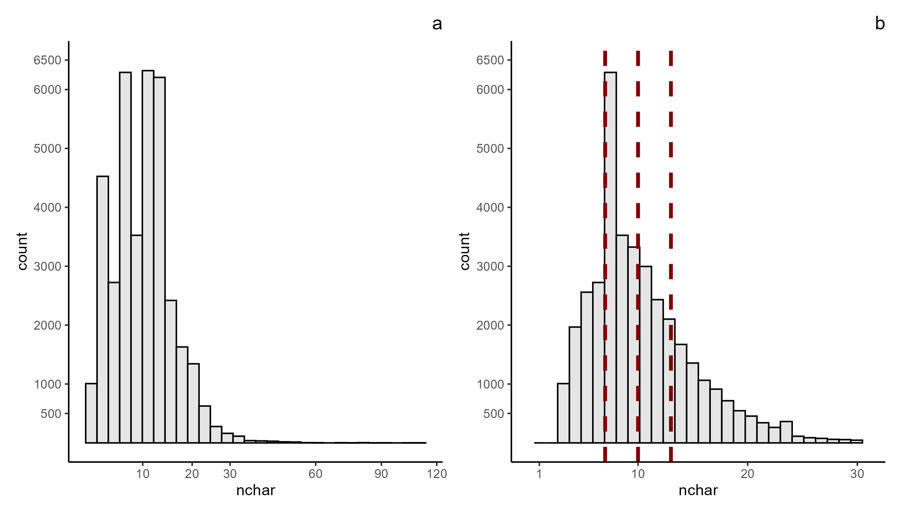
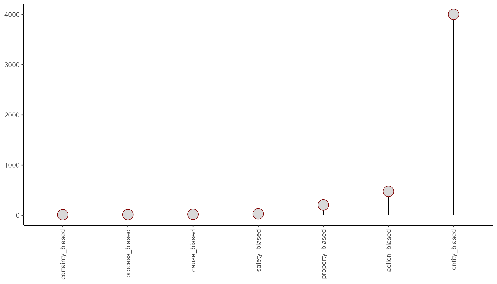

# safety_-_molecularTargets
A glance at the current state of the studies connecting molecular targets and drug safety and development.  

## Work in progress, readme will be updated with the references to the tools and materials used. Licensing of the materials should be done in the case of external usage.

Interaction with undesired molecular targets is one of the reasons why (small molecule) drug candidate may fail during development or developed drug could be recalled from the market.

However, the exact list of undesired molecular targets is a hard topic, since it may vary greatly depending on the exact condition to be treated and multiple other factors.

Thus, in addition to the complex studies aiming to develop such a list or lists (using complex techniques belonging to different approaches) to be applied widely, it is of interest to know what are the molecular targets being studied as potentially safety issues related by the scientiffic community.  

To do that it is possible to simply scan from the list of the articles recently (**01.01.2021 - 15.10.2026** in this cse) published in the scientiffic journals dedicated to the studies of drug safety and development (subject categories, https://www.scimagojr.com/)
in the search for ones, in which potential connection between the molecular target and certain undesired outcome is unequivocally stated.

## Journals were selected among ones related to Drug Development (category) and Drug Safety (title):

1.	Nature Reviews Drug Discovery; https://www.nature.com/nrd/
2.	Cell Chemical Biology; https://www.cell.com/cell-chemical-biology/home
3.	Molecular Therapy; https://www.cell.com/molecular-therapy-family/home   ->   Molecular Therapy Advances
4.	Medicinal Research Reviews; 
5.	MedComm; https://onlinelibrary.wiley.com/journal/26882663
6.	Drug Discovery Today; https://www.sciencedirect.com/journal/drug-discovery-today
7.	Journal of Pharmaceutical Analysis; https://www.journals.elsevier.com/journal-of-pharmaceutical-analysis
8.	Current Opinion in Pharmacology; https://www.sciencedirect.com/journal/current-opinion-in-pharmacology
9.	Expert Opinion on Therapeutic Targets; https://www.tandfonline.com/journals/iett20
10.	Drug Design, Development and Therapy; https://www.tandfonline.com/journals/dddt20
11.	Expert Opinion on Drug Discovery; https://www.tandfonline.com/journals/iedc20
12.	Medicine in Drug Discovery; https://www.sciencedirect.com/journal/medicine-in-drug-discovery
13.	Molecular Pharmaceutics; https://pubs.acs.org/mpohbp
14. Drug Development Research; https://onlinelibrary.wiley.com/journal/10982299
15.	RSC Medicinal Chemistry; https://www.rsc.org/journals-books-databases/about-journals/rsc-medicinal-chemistry/
16.	Current Drug Targets; https://www.eurekaselect.com/journal/13
17. Mini-Reviews in Medicinal Chemistry; https://www.eurekaselect.com/journal/56
18. Chemical Biology and Drug Design; https://onlinelibrary.wiley.com/journal/17470285
19. Current Pharmacology Reports; https://link.springer.com/journal/40495
20. Drug Research; https://www.thieme.in/drug-research
21. Drug Development and Industrial Pharmacy; https://www.tandfonline.com/journals/iddi20
22. Journal of Pharmaceutical Innovation; https://www.springer.com/journal/12247
23. Assay and Drug Development Technologies; https://home.liebertpub.com/publications/assay-and-drug-development-technologies/118/overview
24.	Current Drug Discovery Technologies; https://www.eurekaselect.com/journal/68
25.	International Journal of Drug Discovery and Pharmacology; https://www.sciltp.com/journals/ijddp
26. Pharmaceutical Patent Analyst; https://www.future-science.com/journal/ppa
27. Expert Review of Precision Medicine and Drug Development; https://www.tandfonline.com/journals/tepm20
28. Pharmaceutical Chemistry Journal; https://www.springer.com/journal/11094
29. Drug Safety; https://www.springer.com/journal/40264
30. Pharmacoepidemiology and Drug Safety; https://onlinelibrary.wiley.com/journal/10991557
31. Expert Opinion on Drug Safety; https://www.tandfonline.com/journals/ieds20
32. Therapeutic Advances in Drug Safety; https://journals.sagepub.com/home/taw 
34. Current Drug Safety; https://www.eurekaselect.com/journal/11
35. Drug, Healthcare and Patient Safety; https://www.tandfonline.com/journals/dhps20
36. Frontiers in Drug Safety and Regulation; https://www.frontiersin.org/journals/drug-safety-and-regulation

## Articles's titles (25356) were obtained via PubMed, the results were downloaded manually and gathered using R and Tidyverse

## The scan of the titles will be conducted manually after sorting, just to get the whole picture of the studies in the field

Articles' titles should be arranged for the ease of the scanning and it is a task of its own.

Probably it will be better to start with the analysis of words among those (~47015) constituting titles (preliminary results obtained using (topic) dictionaries from Wikipedia and ChEMBL are not fully satisfactory, this is not the problem of the approach definately, but rather consequence of my skill level with regards to this particular problem). The plan is as follows:

  - Read the titles of articles
  - Get the list of unique words (word here is the sequence of characters between two spaces OR between the line start and space OR between the space and line end)
  - Describe them as vectors of 3-character fragments and measure lengthes
  - Divide words into quartiles by lengthes and binarize their belonging
  - Select the number of descriptors and use them latter to sort words by similarity considering the length's cohorts (shortest, short, neither, long, longest)
  - Label words somehow
  - Exclude not interesting (in this context) words and their descriptors
  - Use the results to sort the titles

### Distribution of the lengthes of the words constituiting the articles' titles

Distributions of words' lengthes are given in Figure 1.

Panel a of Figure 1 represents the full distribution and from it it can be seen that the most of the words are shorter than 30 characters. Panel b of the Figure 1 represents truncated (at 30) distribution, .25, .5 and .75 are marked with red dashed lines (7, 10, 13 characters).

### Label words from stratified list

It was decided to label words as
 - Entity: word, which could be used in titles of the selected articles to describe some object or subject of interest (target, diseases, drug, etc.).
 - Action: word, which could be used in titles of the selected articles to describe something which was done by someone / something and may be of interest (e.g. inhibition or activation of molecular target).
 - Process: word, which could be used in titles of the selected articles to describe something which sort of flows naturally and may be of interest (e.g. biological process).
 - Property: characteristic of entity / action / process and may be of interest.
 - Safety: any word, which could be directly related to the safety concerns.
 - Certainty: any word, which could describe the degree of certainty in something.
 - Cause: any word, which could describe the causal relationship.

The idea is to use this results to create custom stop list, i.e. list of words, which could be excluded from the further analysis; on condition that they maybe out of interest (have few or have no labels) or just use the results as additional descriptors.

#### Shortest words

Words having length lesser than 8 characters were manually categorized, the results are given in Figure 2.

As it can be seen from Figure 2 the most of these words are some entities (biological targets, chemical compounds, etc.), also, there are only few words directly related to safety. The whole process is quite tedious and error prone, thus some automation is needed. The most simple option is to use dictionaries from various sources. Also, the direct usage of some neural net may be even easier, however, ground level for comparison is still needed in this case (titles are special matter, e.g. [https://royalsocietypublishing.org/rspb/article/291/2027/20241222/105261/Title-abstract-and-keywords-a-practical-guide-to], [https://explore.plos.org/author-resources/how-to-write-a-compelling-title]). One of the established ways to get vocabularies, where words are mapped to some topic, is to work through an ontologies; which are, hopefully, are well (for this task) represented on 

https://bioportal.bioontology.org/

The following ontologies are seems to be relevant for this task:

- Chemical Entities of Biological Interest Ontology, https://bioportal.bioontology.org/ontologies/CHEBI
- An ontology for experimental actions, https://bioportal.bioontology.org/ontologies/EXACT
- Bioentities, https://bioportal.bioontology.org/ontologies/BE
- Drug Target Ontology, https://bioportal.bioontology.org/ontologies/DTO
- Experimental Factor Ontology, https://bioportal.bioontology.org/ontologies/EFO
- Hierarchical Event Descriptors, https://bioportal.bioontology.org/ontologies/HED
- Toxic Process Ontology, https://bioportal.bioontology.org/ontologies/TXPO
- Biological Pathway Taxonomy, https://bioportal.bioontology.org/ontologies/BPT
- Pathway Ontology, https://bioportal.bioontology.org/ontologies/PW
- Interaction Network Ontology, https://bioportal.bioontology.org/ontologies/INO
- Evidence Graph Ontology, https://bioportal.bioontology.org/ontologies/EVI
- Molecular Interaction Map, https://bioportal.bioontology.org/ontologies/MIM
- WikiPathways, https://bioportal.bioontology.org/ontologies/WIKIPATHWAYS
- Systems Chemical Biology and Chemogenomics Ontology, https://bioportal.bioontology.org/ontologies/CHEMBIO
- Adverse Event Reporting Ontology, https://bioportal.bioontology.org/ontologies/AERO
- Molecular Interactions, https://bioportal.bioontology.org/ontologies/MI
- Ontology for Drug Discovery Investigations, https://bioportal.bioontology.org/ontologies/DDI
- Ontology for Biomedical Investigations, https://bioportal.bioontology.org/ontologies/OBI
- Ontology of Adverse Events, https://bioportal.bioontology.org/ontologies/OAE
- Ontology of Drug Adverse Events, https://bioportal.bioontology.org/ontologies/ODAE
- The Biomarker Ontology, https://bioportal.bioontology.org/ontologies/BMONT
- The Drug Ontology, https://bioportal.bioontology.org/ontologies/DRON
- The Drug-Drug Interactions Ontology, https://bioportal.bioontology.org/ontologies/DINTO

Such a long list does not mean that all these ontologies are needed, since they may have intersected terms, however, at this stage - OK.
Also, valuable vocabularies representing already adapted ontologies and other sources may be obtained from databases describing molecules, such as ChEMBL [https://www.ebi.ac.uk/chembl/] and, even better, EBI developed and hosts web application, Text Tagger (https://www.ebi.ac.uk/ols4/tag-text), allowing to annotate text using multiple ontologies and save the results, downloading the mappings from ontologies is also possible (https://www.ebi.ac.uk/ols4/downloads) - **CCO license**.
